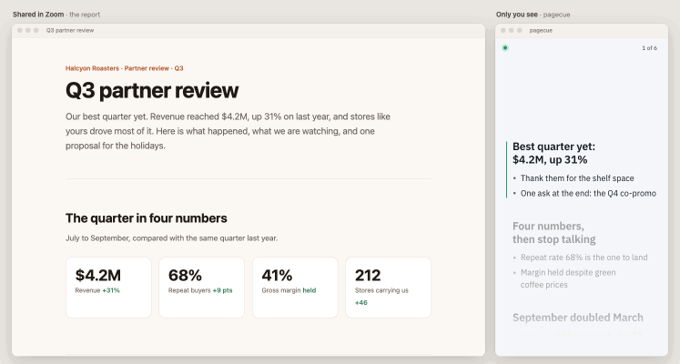

<p align="center">
  
</p>

<h1 align="center">pagecue</h1>

<p align="center">
  <b>Speaker notes for any web page, written with Claude.</b><br>
  A private prompter that follows the page as you scroll,<br>
  with cues you and Claude write and change together.
</p>

<p align="center">
  <a href="https://github.com/pakothealpaco/pagecue/actions/workflows/ci.yml"></a>
  <a href="LICENSE"></a>
  
</p>

<p align="center">
  
</p>

More of what we present is now made with Claude: reports, research, dashboards, whole sites. They aren't slides, so there are no speaker notes, and you end up memorising numbers, or losing your place when someone interrupts.

pagecue gives any page a presenter view, and it's built around Claude. Tell Claude what you want to say; it finds the breakpoints on the page and writes short cues. While you rehearse, ask for changes and watch the prompter update. Then share only the page, and your cues follow along in a window no one else sees.

**Try it in two minutes:** [install the extension](#install), open the [demo report](https://pakothealpaco.github.io/pagecue/demo/) and click the pagecue icon. The cues are already there.

## How it works with Claude

1. **Tell Claude what you want to say**, in Claude Code, the Claude app or Claude in Chrome:
   > Add pagecue cues to this report. On the revenue chart I want to say September doubled March.

   The `add-cues` skill plans where each cue starts, asks once what you want to say there, and writes each cue as a headline and up to three short points, using only facts from the page or from you.
2. **Open the page and click the pagecue icon.** The prompter opens in its own window with your cues.
3. **Rehearse, and keep asking.** *"Shorten cue 3." "Add a cue here about the price." "Write them in Hebrew."* Claude sees the page you're on and the cue that's lit, and every change shows up at once, with Undo.
4. **Present.** Share only the page's tab in Zoom, Meet or Teams. Scroll, and the right cue lights up; click a cue, and the page scrolls to it.

## What you get

- **A Claude skill and a live link.** The `add-cues` skill writes cues the way a good speaker uses notes: glanceable, factual, in your language. Through the plugin, Claude can operate the prompter for you: add, reword, jump, show section lines.
- **Private.** The prompter is a separate window, so sharing the page's tab or window leaves it out.
- **Yours to edit, too.** Double-click a cue to reword it, press <kbd>N</kbd> to add one where you are, use <kbd>↓</kbd> <kbd>↑</kbd> or a clicker to move.
- **Works with what you present.** Long reports, dashboards, web apps and claude.ai artifacts, in any language.
- **No account, no cloud.** Cues stay in your browser; Claude reaches them only on your own computer.

## Install

**The extension.** A Chrome Web Store listing is coming. Until then, it takes a minute:

1. Download `pagecue-extension.zip` from the [latest release](https://github.com/pakothealpaco/pagecue/releases/latest) and unzip it.
2. Open `chrome://extensions`, turn on **Developer mode**, click **Load unpacked** and choose the unzipped folder.

Chrome shows a Developer mode notice for extensions installed this way; that's expected until the store listing is live. Works in Chrome, Edge, Brave and Arc, and asks for no site access until you click it on a page.

**The Claude plugin.** In Claude Code:

```
/plugin marketplace add pakothealpaco/pagecue
/plugin install pagecue@pagecue
```

(The marketplace and the plugin are both called `pagecue`. Needs Node 20 or later.) Then ask for cues on any page, or run `/pagecue:add-cues`. To use it from the Claude desktop app or Claude in Chrome, see [Working with Claude](docs/working-with-claude.md). The extension also works on its own, with cues you write by hand or that a page ships with.

## Status and limitations

Early beta (0.x): it works well on the pages we've tested, and we'd love bug reports.

- Chromium browsers only for now.
- Share the page's tab or window, not your whole screen: a shared screen includes the prompter.
- Section lines (<kbd>L</kbd>), which show on the page where each cue starts, are visible to viewers. Turn them off before you present.
- Claude in Chrome can edit cues through `window.pagecue` while the prompter is open; so could the page's own scripts. Turn it off in the prompter's ··· menu if you don't use it. See [PRIVACY.md](PRIVACY.md).

## Learn more

- [Presenting with pagecue](docs/guide.md): every key, section lines, adding and deleting cues.
- [Working with Claude](docs/working-with-claude.md): the `add-cues` skill, live changes, the Claude app, Claude in Chrome, the MCP tools.
- [Ship cues with your page](docs/cue-format.md): for report generators and sites.
- [How it works](docs/how-it-works.md), [privacy](PRIVACY.md) and [security](SECURITY.md).

## Contributing

Bug reports, ideas and pull requests are welcome. To build from source (Node 20 or later):

```bash
git clone https://github.com/pakothealpaco/pagecue.git
cd pagecue/extension && npm ci && npm run build   # extension/.output/chrome-mv3
```

See [CONTRIBUTING.md](CONTRIBUTING.md) for tests and checks.

## License

[MIT](LICENSE)

---

<p align="center">
  Made by <a href="https://github.com/pakothealpaco">Paco the Alpaca</a>.
</p>
